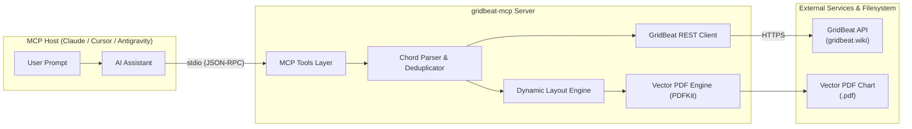

# 🎵 gridbeat-mcp

[](https://modelcontextprotocol.io/)
[](https://www.typescriptlang.org/)
[](https://nodejs.org/)
[](https://vitest.dev/)
[](https://opensource.org/licenses/MIT)

> **Empower AI assistants with deterministic music theory, controller chord mapping, and print-ready vector PDF chord sheet generation.**

`gridbeat-mcp` is a production-grade [Model Context Protocol (MCP)](https://modelcontextprotocol.io/) server that interfaces with the [GridBeat Chord Shapes API](https://github.com/leouofa/gridbeat/blob/main/API.md). It transforms natural language music queries into exact chord fingerings across modern hardware controllers and acoustic instruments, rendering publication-ready, space-optimized vector PDFs directly from conversational prompts.

---

## 🌟 Why gridbeat-mcp?

Whether you are jamming with an **Ableton Push**, practicing fretboard transitions on **guitar**, or drafting song chord charts, `gridbeat-mcp` gives AI agents (such as Claude, Cursor, and Antigravity) deep music theory and instrument awareness:

- **Hardware & Acoustic Native**: Direct support for 8×8 pad controllers (Push, Launchpad) and traditional instruments (Piano, Guitar, Ukulele).
- **Pure Vector Generation**: Instant, high-resolution vector PDF rendering using PDFKit—zero headless browser or rasterization overhead.
- **Smart Space Optimization**: Custom 2D layout engine dynamically calculates the optimal `columns × rows` grid per page, maximizing diagram sizes to eliminate wasted paper margins.
- **Deduplication with Progression Fidelity**: Repeated chords across song sections are deduplicated into unique diagrams while preserving and displaying the exact progression sequence in the header.
- **Harmonic Consistency**: Automatically harmonizes Ableton Push in `inKey` mode by locking the scale root to the progression's tonal center.

---

## 🏗️ Architecture



---

## 🚀 Key Features

### 1. Multi-Instrument Support Matrix

| Instrument | Controller / Fretboard Type | Default Orientation | Configurable Parameters |
| :--- | :--- | :--- | :--- |
| **Ableton Push** | 8×8 isomorphic pad grid | Portrait | `pushMode` (`chromatic`, `inKey`), `pushLayout` (`4ths`, `3rds`, `sequent`), `scale` (`Major`, `Minor`) |
| **Novation Launchpad** | 8×8 pad grid | Portrait | `gridWidth` (row step width: 2, 3, 4, 5, 8) |
| **Piano** | Multi-octave keyboard | Landscape | `octaves` (1, 2, 3, or 4 octaves; default: 2) |
| **Guitar** | 6-string standard tuning fretboard | Landscape | `guitarFrets` (3, 5, 7, 9, or 12 frets) |
| **Ukulele** | 4-string standard tuning fretboard | Landscape | `ukuleleFrets` (3, 5, 7, 9, or 12 frets) |

### 2. Space-Maximized Vector PDF Engine
- **Orientation-Aware Geometry**: Automatically selects **Portrait** for square pad matrices (`push`, `launchpad`) and **Landscape** for horizontal layouts (`piano`, `guitar`, `ukulele`).
- **Aspect-Ratio Preserving Grid Solver**: Given any chord count and printable boundary, the layout solver iteratively tests grid factorizations to maximize individual chord diagram scale.
- **Studio & Print Themes**:
  - `color`: Clean, print-friendly white layout with GridBeat's signature chord color coding.
  - `bw`: Ink-saver high-contrast grayscale for home printers.
  - `dark`: High-contrast dark palette tailored for stage and studio displays.
- **Paper Formats**: Full support for both standard US `LETTER` and international `A4`.

### 3. Intelligent Chord Parsing
Handles flexible human and agent inputs interchangeably:
- **Shorthand Symbols**: `"C"`, `"Am"`, `"F#m"`, `"Bb7"`, `"Emaj7"`, `"Dsus4"`, `"G5"`
- **Structured Objects**: `{ root: "F#", chord: "Minor" }`
- **Microtonal / Custom Intervals**: `{ root: 1, chord: [1, 4, 3] }`

---

## 🛠️ MCP Tools

### `get_chord_shapes`
Queries GridBeat for one or more chords and returns structured note lists, pitches, intervals, and active instrument pad/fret/key coordinates.

#### Example Arguments
```json
{
  "chords": ["Am", "F", "C", "G"],
  "instruments": ["push", "guitar"],
  "config": {
    "pushMode": "chromatic",
    "pushLayout": "4ths",
    "guitarFrets": 5
  }
}
```

---

### `generate_chord_sheet_pdf`
Generates a publication-quality, print-optimized PDF chord sheet for a chosen instrument.

#### Example Arguments
```json
{
  "chords": ["C", "G", "Am", "F", "C", "G"],
  "instrument": "guitar",
  "title": "Pop Progression in C Major",
  "theme": "color",
  "pageSize": "LETTER",
  "config": {
    "guitarFrets": 5
  }
}
```

#### Sample LLM Prompts
- *"Create a guitar chord sheet PDF for the chords in 'Let It Be' (C, G, Am, F) with 5 frets."*
- *"Show me how to play a Dm9 -> G13 -> Cmaj7 jazz turnaround on my Ableton Push in inKey mode."*
- *"Export an ink-saver B&W PDF chord chart for ukulele covering D, Bm, G, A on A4 paper."*

---

## 📦 Quickstart & Installation

### Prerequisites
- Node.js >= 18.0.0
- npm or pnpm

### Build from Source

```bash
git clone https://github.com/leouofa/gridbeat-mcp.git
cd gridbeat-mcp
npm install
npm run build
```

Run test suite:
```bash
npm test
```

---

## 🔌 MCP Client Configuration

### Claude Desktop

Add this entry to your Claude Desktop configuration file:
- **macOS**: `~/Library/Application Support/Claude/claude_desktop_config.json`
- **Windows**: `%APPDATA%\Claude\claude_desktop_config.json`

```json
{
  "mcpServers": {
    "gridbeat": {
      "command": "node",
      "args": ["/ABSOLUTE/PATH/TO/gridbeat-mcp/dist/index.js"],
      "env": {
        "GRIDBEAT_API_URL": "https://www.gridbeat.wiki"
      }
    }
  }
}
```

### Cursor / Antigravity / Windsurf

Add to your project's `.cursor/mcp.json` or your MCP client's configuration:

```json
{
  "mcpServers": {
    "gridbeat": {
      "command": "node",
      "args": ["/ABSOLUTE/PATH/TO/gridbeat-mcp/dist/index.js"]
    }
  }
}
```

---

## ⚙️ Environment Variables

| Variable | Description | Default |
| :--- | :--- | :--- |
| `GRIDBEAT_API_URL` | Base URL for the GridBeat REST API | `https://www.gridbeat.wiki` |

---

## 🧩 Developer Portfolio Highlights

This project demonstrates expertise in:
- **Protocol Engineering**: Implemented with `@modelcontextprotocol/sdk` using TypeScript and Zod schema validations for rock-solid runtime contract enforcement.
- **Mathematical Layout Solver**: Custom 2D layout calculation algorithm (`layoutEngine.ts`) resolving multi-variable constraints (aspect ratio, margins, header heights, cell padding) in real time.
- **Vector Rendering Architecture**: Modular canvas-style renderers (`gridRenderer`, `fretboardRenderer`, `pianoRenderer`) cleanly decoupled from PDF generation logic.
- **Thorough Test Coverage**: Comprehensive Vitest test suite testing parsing edge cases, mathematical bounding boxes, and multi-page vector generation.

---

## 📄 License

This project is licensed under the [MIT License](LICENSE).
